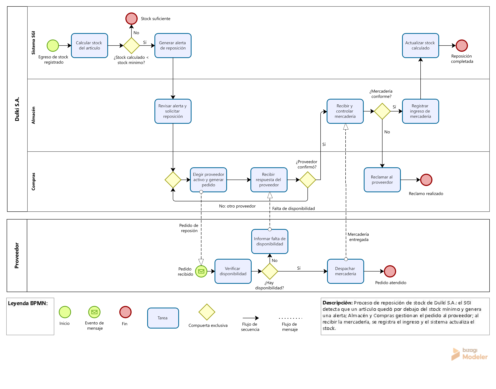

# Dulkí S.A. – Sistema de Gestión de Inventario (SGI)

Trabajo Práctico Integrador (TPI) de **Organización Empresarial**, Tecnicatura Universitaria en Programación a Distancia – Universidad Tecnológica Nacional (UTN).

## Descripción

Dulkí S.A. es una empresa ficticia que elabora alfajores artesanales, con planta en la zona sur del Gran Buenos Aires (GBA) y oficinas en la Ciudad Autónoma de Buenos Aires (CABA). Este repositorio documenta la Entrega N.º 4 del TPI: el modelado del proceso de **reposición de stock** que automatiza el Sistema de Gestión de Inventario (SGI), junto con la gestión colaborativa del proyecto y los mecanismos de control.

## Integrante

- Milagros Ifran – Legajo 105598 (trabajo individual)

## Contenido del repositorio

- `bpmn_reposicion_stock.png` – Diagrama BPMN del proceso de reposición de stock.
- `bpmn_reposicion_stock.bpm` – Modelo editable (Bizagi Modeler).
- `indicadores_control.md` – Indicadores de control y estándares de desempeño.

## Proceso de negocio (BPMN)

El diagrama tiene dos pools (Dulkí S.A. y Proveedor) y tres lanes internos (Sistema SGI, Almacén y Compras). El flujo estándar incluye compuertas exclusivas para las excepciones: stock suficiente, proveedor que no confirma, mercadería no conforme y falta de disponibilidad del proveedor.

## Tablero ágil

Tablero en GitHub Projects: [Tablero SGI – Reposición de stock](https://github.com/users/milagrosmagali02-creator/projects/1)

| Historia de usuario | Issue | Estado |
|---|---|---|
| HU-01: Alerta de stock mínimo | #2 | Listo |
| HU-02: Pedido de reposición | #3 | En Progreso |
| HU-03: Registro del ingreso de mercadería | #4 | Por Hacer |

El avance de los estados es una simulación, porque el sistema aún no está desarrollado.

## Indicadores de control

Los indicadores y estándares de desempeño están en [indicadores_control.md](indicadores_control.md).

## Declaración de Uso de IA

Para esta entrega utilicé Claude (Anthropic) como asistente de apoyo. Su uso se limitó a ordenar el trabajo, sugerir ideas, proponer borradores y guiarme en el uso de las herramientas.

### Prompts utilizados y su justificación

1. **Elección del proceso a modelar.** Pedí alternativas de procesos del SGI para el BPMN y elegí la reposición de stock, porque aprovecha el stock calculado y el stock mínimo del diccionario de datos.
2. **Consultas a la cátedra.** Pedí ayuda para formular preguntas sobre la revisión de pares y las historias de usuario. Preferí consultar y adopté lo que respondió la cátedra.
3. **Verificación en el material.** Pedí revisar si las Unidades 4 y 5 explicaban las historias de usuario, porque quería basarme en el material de la cátedra para definir las tres historias que pide la consigna.
4. **Guía paso a paso de GitHub y el tablero.** Pedí instrucciones para GitHub Desktop y GitHub Projects, porque no tengo casi experiencia con estas herramientas.
5. **Justificación de los indicadores.** Pedí que me explicara por qué se eligieron los cinco indicadores propuestos y cómo se relacionan con el material de la cátedra, para verificar su coherencia con ese material.

### Mis correcciones sobre los resultados de la IA

- **BPMN:** el asistente generó un primer borrador gráfico del proceso. Lo rehíce en Bizagi Modeler y corregí detalles, por ejemplo, que "Stock suficiente" debía ser un evento de fin.
- **Indicadores:** los cinco indicadores y sus estándares fueron propuestos por el asistente. Los revisé, entendí su relación con el material y los adopté como propuestas propias.
- **Historias de usuario:** fueron propuestas por el asistente en el formato "Como…, quiero…, para…" del material de la cátedra, ya asociadas a tareas del BPMN. Las revisé y confirmé con la cátedra que debía definirlas yo y que alcanzaba con relacionarlas con el BPMN.
- **Tablero:** el avance de los estados (Por Hacer, En Progreso, Listo) es una simulación, porque el sistema aún no está desarrollado.

Entiendo que los errores del asistente son mi responsabilidad, y por eso verifiqué cada resultado antes de incorporarlo.

## Revisión de Pull Requests

La revisión del Pull Request #1 (portada y contenido del README) fue realizada por el propio autor por tratarse de un trabajo individual; los comentarios y la checklist de revisión quedan documentados en ese PR.